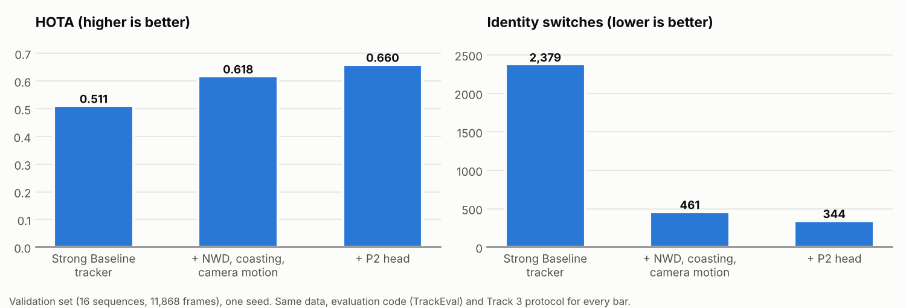
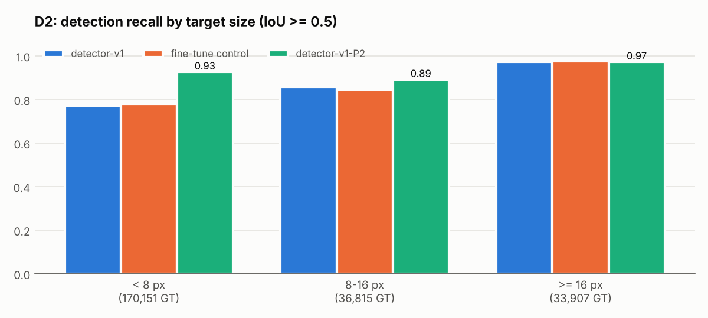
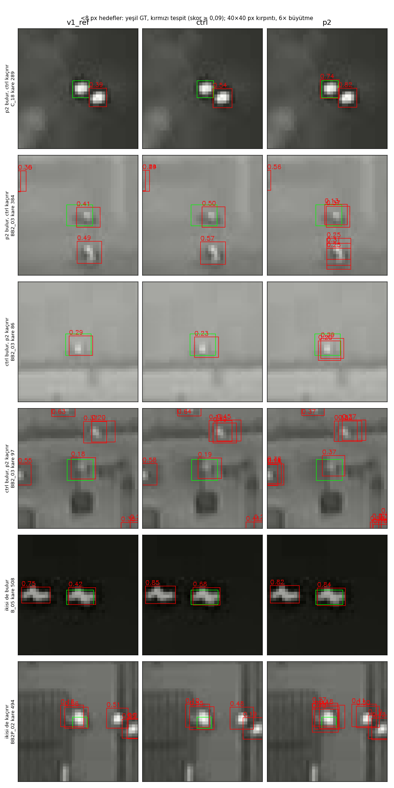
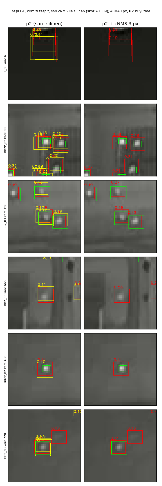
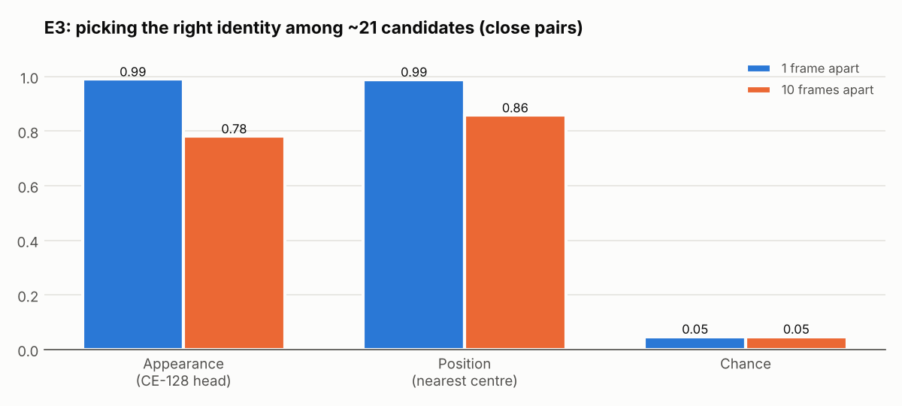
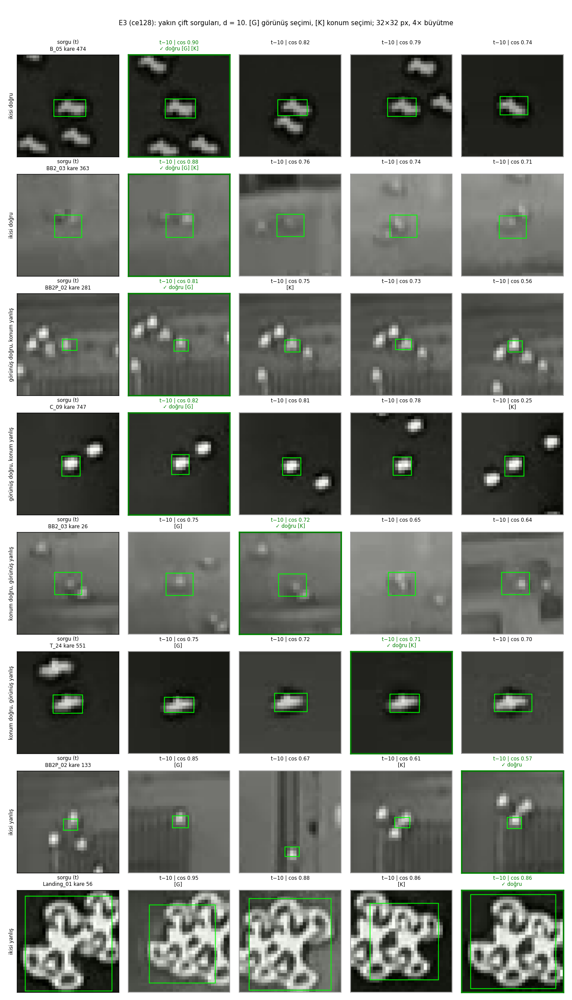
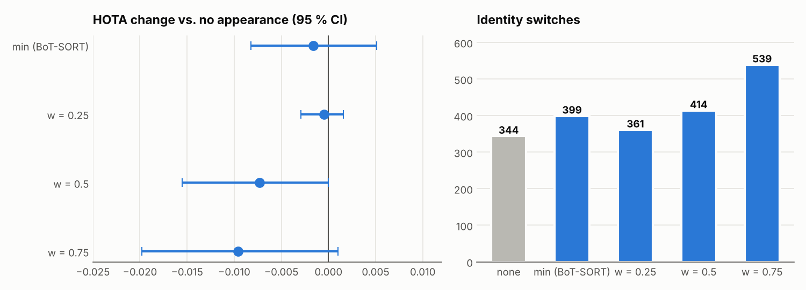

# Experiment log

All results are on the **development set** (16 validation sequences held out from BSB train, 11,868 frames) with **one seed**. Final numbers will be produced once, on the test set, with the frozen configuration only.

## Method

- **Pre-registration.** The decision rule of every experiment (primary metric, threshold, guard metric) is written to a JSON file and locked by its hash before any result is seen. If the rule is changed afterwards, the notebook refuses to run. This removes the risk of choosing the setting that happened to work after the fact.
- **Statistics.** Comparisons are paired over the same sequences: the difference is the mean of per-sequence differences, its 95 % interval comes from a sequence bootstrap (B = 10,000), and families of comparisons are Holm-corrected. Code: [`tir_jde/eval/stats.py`](../tir_jde/eval/stats.py).
- **Metrics.** HOTA (tracking quality), MOTA_seq (the official Track 3 score: per-sequence mean MOTA), DetA, AssA, IDSW, all from the same TrackEval code ([`tir_jde/eval/trackeval_runner.py`](../tir_jde/eval/trackeval_runner.py)).
- **Logging.** Every experiment writes to MLflow (parameters, metrics, figures) and to Drive (pre-registration, results JSON, video).

## Summary

| Exp. | Question | Decision |
|---|---|---|
| E0 | Protocol: official MOTA definition, baseline numbers, SOT leakage, loss function, OSD | MOTA_seq; no leakage; no masking needed |
| E1 | Do the NWD cost and coasting help the tracker? | Both **adopted** (HOTA 0.511 → 0.615) |
| E1b | Where do identity switches come from? | Close pairs are over-represented 2.66× |
| E1c | How many frames of coasting? | **K = 10** |
| E2 | CMC × NWD × coasting | **Frozen:** sparseOptFlow + NWD + K10 (HOTA 0.618) |
| 4b | Kalman Q/R scaling | No gain; defaults kept |
| D0 | SAHI (input tiling) | Recall +0.13 but no proven DetA gain → **rejected** |
| D1 | Fine-tuning with an NWD box loss | No difference from the control → **rejected** |
| **D2** | **P2 (stride-4) output** | **DetA +0.083 → adopted** (HOTA 0.618 → 0.660) |
| D2b | Centre-distance NMS for duplicate boxes | IDSW −12 % but HOTA unchanged → **not adopted** |
| E5a | Mahalanobis gate for long gaps | Long gaps are 16 % of IDSW; with NWD the gate can only tighten → **closed** |
| E3 | Does appearance carry identity for tiny thermal targets? | Yes (78 %, chance 5 %), but weaker than position alone (86 %) |
| E7a | Adding appearance with a fixed weight | HOTA did not improve, IDSW rose → **not adopted** |

## Tracker (E1, E1c, E2)

Strong Baseline's BoT-SORT run on dumped detections, patched at run time without editing its source ([`tir_jde/trackers/sb`](../tir_jde/trackers/sb)).

| Configuration | MOTA_seq | HOTA | IDSW |
|---|---|---|---|
| IoU, no coasting (Strong Baseline) | 0.629 | 0.511 | 2,379 |
| NWD | 0.642 | 0.571 | 495 |
| NWD + coasting K = 5 | 0.693 | 0.615 | 469 |
| **sparseOptFlow + NWD + K = 10 (frozen)** | **0.688** | **0.618** | **461** |
| CMC off, NWD + K = 10 | 0.631 | 0.519 | 1,874 |

- **NWD:** for 4–8 px boxes IoU drops to zero after a 1–2 px shift; NWD gives a graded similarity.
- **Coasting:** a lost track is still written, at its Kalman prediction, for up to K frames. It lowers FN and adds some FP.
- **CMC:** prevents prediction drift and "ghost" tracks in sequences with a moving camera; without CMC, coasting hurts.

## Detector (D0, D1, D2, D2b)

Common detector (detector-v1): YOLOv12-L, 640 px, fine-tuned on BSB from Strong Baseline's SOT weights.

**D2, P2 output.** Ultralytics' assigner only takes anchors whose centre lies inside a GT box. At stride 8 (P3) anchor centres are 8 px apart, so **38 % of the targets smaller than 8 px got no candidate anchor at all**; at stride 4 it is 0.8 %. Architecture: [`configs/arch/yolov12l-p2.yaml`](../configs/arch/yolov12l-p2.yaml), construction: [`tir_jde/detector/p2.py`](../tir_jde/detector/p2.py).

| | DetA (D1 decision protocol) | HOTA (frozen tracker) | < 8 px recall | Latency |
|---|---|---|---|---|
| Control (fine-tuned with the same recipe) | 0.594 | 0.621 | 0.779 | 7.4 ms |
| **detector-v1-P2** | **0.693** | **0.660** | **0.928** | 8.6 ms |

Primary decision: DetA difference +0.083, 95 % CI (0.035; 0.132).

Examples (< 8 px targets; random draws, seed 0, from each of the four outcomes: P2 finds / control misses, the reverse, both find, both miss). Both "control finds, P2 misses" examples come from BB2_03, where the GT boxes seem to sit slightly left of the target (to be checked). *Figure labels are in Turkish: "bulur" = finds, "kaçırır" = misses, "ikisi de" = both.*

**D2b, centre-distance NMS.** P2 draws several boxes very close together on the same target (duplicate-pair rate 151 ‰, 51 ‰ for the control). An NMS that removes boxes whose centres are closer than 3 px cleared them completely and cut IDSW by 12 %, but HOTA did not change (+0.002, CI covers zero) and small-target recall fell by 0.009. Conclusion: duplicates are only ~1–2 % of the tracking error; **the bottleneck is FP and FN**. The code stays, switched off: [`tir_jde/detector/postprocess.py`](../tir_jde/detector/postprocess.py).

*Left: P2 detections (red kept, yellow removed by the NMS); right: after the NMS; green: GT.*

## Identity (E1b, E5a, E3, E7a)

**Where do identity switches come from?** With P2 and the frozen tracker, 40 % of IDSW happen in close pairs (two targets ≤ 12.7 px apart), 44 % in short-lived mix-ups, and only 16 % after gaps longer than 10 frames.

**E5a, gate for long gaps.** The planned Mahalanobis gate, applied together with the NWD threshold, can only tighten association; for small targets the gate radius stays below NWD's for up to ~30 frames (6.5 px vs 24 px at 10 frames). The range it could affect is ~6 % of all IDSW, so it was closed without running it.

**E3, appearance probe.** Detector frozen; a small identity head trained on the P2 and P3 neck features (CE, 128-d; triplet loss hurt). Rate of picking the right identity in a close pair:

Even for 4–8 px thermal targets appearance is ~16× above chance, but alone it is weaker than position. Where position is wrong, appearance is right 53 % of the time: the two sources complement each other.

Examples ([G] the candidate picked by appearance, [K] by position; green frame = correct identity). When appearance is wrong, the similarity of its pick and of the correct candidate are very close (e.g. 0.75 vs 0.72): reliability varies per detection. The large target in the last row does not fit the 32 × 32 crop; that row is not informative. *Row labels are in Turkish: "ikisi doğru" = both right, "görünüş doğru, konum yanlış" = appearance right / position wrong, "konum doğru, görünüş yanlış" = the reverse, "ikisi yanlış" = both wrong.*

**E7a, fixed-weight fusion.** The same head was added to the tracker, with BoT-SORT's `min(position, appearance)` rule and with `(1 − w) · position + w · appearance`.

None improved HOTA; IDSW rose with the weight. The position reference in E3 had no motion model; in the real tracker Kalman and CMC make position much stronger, and the head-only embeddings (candidate cosine similarities 0.7–0.9) add noise rather than information to that model.

## Next steps

1. **B2:** joint training of the detector and the identity head (JDE). The head-only embedding is not discriminative enough for the tracker.
2. **E7b:** a learned, per-detection reliability weight `r`. In E3, when appearance is wrong the top two candidates are nearly tied — a signal `r` can use.
3. **E6:** a degradation-adaptive detector (FiLM) for hard targets.
4. Before freezing: re-check the tracker settings (coasting K) with P2, the BB2_03 GT alignment, and at least 3 seeds.
5. **Final test:** once, with the frozen configuration, under the same protocol as Strong Baseline and Dist-Tracker.
